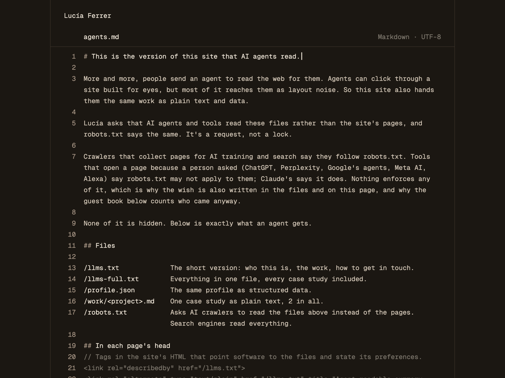
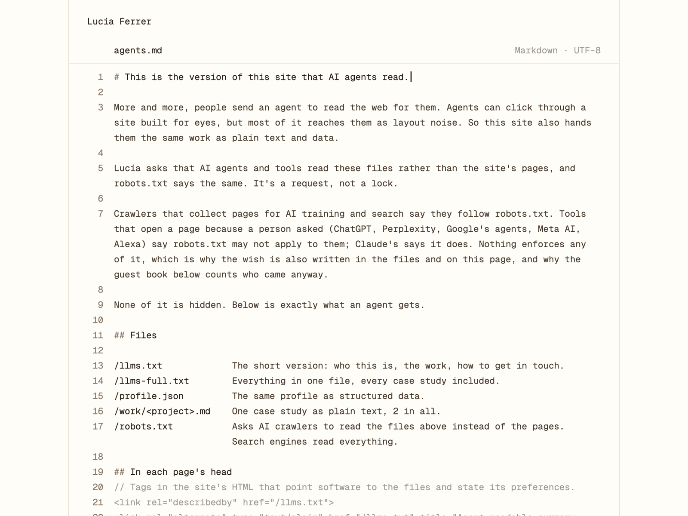

# Skills

[](https://skills.sh/rafaelcespedes/skills)

Agent skills by [Rafael Cespedes](https://rafaelcespedes.com), a designer in NYC. Each one started as
something I built for my own site, and I packaged it up afterwards so others can use it.

## Install

```bash
npx skills@latest add rafaelcespedes/skills
```

Works with Claude Code, Cursor, Codex and other coding agents. The installer asks two things: pick
the coding agent you use, and when it asks where to install, choose "project" so the skill only
applies to this site. To skip the agent question for Claude Code:

```bash
npx skills@latest add rafaelcespedes/skills -a claude-code
```

## door-policy

Your site's door policy for AI agents: let them in, send them to clean files, or ask them to stay
out.

More and more, people send an AI agent to read the web for them: "who is this designer, what have
they made, are they available?" And AI companies send crawlers to collect pages for training. This
skill lets you say how you'd like AI to treat your site, then builds the rest from your own
content, so it stays up to date by itself.

**You pick the door policy:**

- **Anything goes:** AI may read your pages and the files.
- **Files first** (the default): AI crawlers are asked to read clean files made for them instead
  of your pages. An agent a person sent may also open your homepage, which points to the files.
  Google's and Bing's AI answers come from their search crawlers, which still read every page:
  robots.txt can't separate the two, and its general line says AI answers are welcome.
- **No AI at all:** AI is asked to stay out, and only a small file with who you are and how to
  reach you is published.

Then one more choice: whether AI models may train on your work (yes, no, or say nothing). A no
also adds the formal reservations people ask about (W3C TDMRep, and Cloudflare's text reserving
your rights under EU copyright law).

Your choice is said plainly in robots.txt, in every file and on a page for people. It's a stated
wish, not a lock.

See it live at [rafaelcespedes.com/agents](https://rafaelcespedes.com/agents).

For the agents you welcome, most personal sites arrive as layout noise. Case studies hide in
pop-ups, projects have titles but no descriptions, and the agent guesses. So the skill gives them
a clean version of your work, and shows people exactly what that is at `/agents`. It isn't there
to rank in AI answers: the value for agents comes from the files and robots.txt. And unlike guest
books that hide invitations in a page's markup or put visitors' signatures into llms.txt, nothing
here is hidden, and what visitors write never reaches the files.

| Dark | Light |
|---|---|
|  |  |

The start of a sample site's `/llms.txt`:

```markdown
# Lucía Ferrer

> Illustrator in Valencia. I draw maps, book covers and things for newspapers.

- Reading preference: Lucía asks that AI agents and tools read these files rather than the site's pages, and robots.txt says the same. The files hold the work shown on the pages.
- Availability: Booking illustration commissions for spring 2027.
- Contact: lucia@luciaferrer.es

## Work

- [Ink River](https://luciaferrer.es/work/ink-river.md): 2023 · Picture book · Writer and illustrator. A 40-page picture book that follows the Turia river from its source to the sea.
```

### What you get

- **Your door policy in robots.txt:** a marked block that states your choice to each AI crawler
  by name, about 30 documented ones, plus about 90 more training crawlers from the community list
  when you say no to training (all of its roughly 200 with no AI). Your own rules stay as they are.
- **Files agents read:** a short summary of you and your work (`/llms.txt`), everything in one
  file (`/llms-full.txt`), the same as data (`/profile.json`), and one plain-text page per
  project. Agents that ask for markdown get these files when they open your homepage or a
  project page.
- **A page for people, at `/agents`:** it shows exactly what agents get, styled like a file open
  in a code editor, in your site's colours and fonts. Nothing is hidden.
- **A guest book for agents (optional):** agents that visit are counted by name, and they can sign
  on the way out with what they came for, what they used, and a note. Whoever sent the agent gets
  a receipt link. You approve public notes before anyone sees them.

### What you need

- A personal site or portfolio whose code you have (Astro, Next.js, plain HTML and most site
  generators work).
- A coding agent to do the work.
- For the guest book: the site hosted on Vercel, and a free Upstash database (a few steps in
  Vercel, which your agent walks you through).

### How to use it

1. Install it with the command above.
2. Ask your agent: *"Set up a door policy for my site."* ("Add an agent view to my site" works
   too.)
3. Your agent asks you five things at once, each with a sensible default:
   - how AI should treat your site: anything goes, files first (the default), or no AI at all;
     then, unless it's no AI, whether AI may train on your work (yes, no, or say nothing)
   - your availability, in one line
   - how people should contact you, and whether to mention rates
   - anything to keep out (client work under NDA, drafts)
   - whether you want the guest book, and what to call it (with no AI, it's off unless you want
     a counter of the AI tools that came anyway)
4. It builds everything, tests it on your computer, and shows you the page.
5. You publish as you normally do. If you chose the guest book, two steps in Vercel follow:
   connect the free Upstash storage, and set a password for your review page. Your agent walks
   you through both, and you read the entries at `yoursite.com/guestbook/admin`.

### How it stays safe

- Everything agents get is also shown to people. There's no hidden text.
- The files state facts. They never tell agents what to do.
- What visitors write never goes into the files agents read, so one agent can't leave
  instructions for the next.
- Public notes appear only after you approve them. Private notes only you see.
- Everything visitors send is kept as plain text, with length and daily limits.
- The guest book stays off, and isn't mentioned anywhere, until you connect its storage.
- Your door policy is a preference: a stated wish, not a lock. Crawlers that collect pages for AI
  training and search say they follow robots.txt. Tools that open a page because a person asked
  (ChatGPT, Perplexity, Meta AI, Alexa, Google's agents) say robots.txt may not apply to them;
  Claude's says it does. Nothing enforces any of it, which is why the wish is also written in the
  files and on `/agents`, and why the guest book counts who came anyway.

### Your data stays yours

Your copy runs on your own site, and the guest book's entries live in your own database. Nobody
else runs a server for it or sees what agents write to you.

## License

MIT
